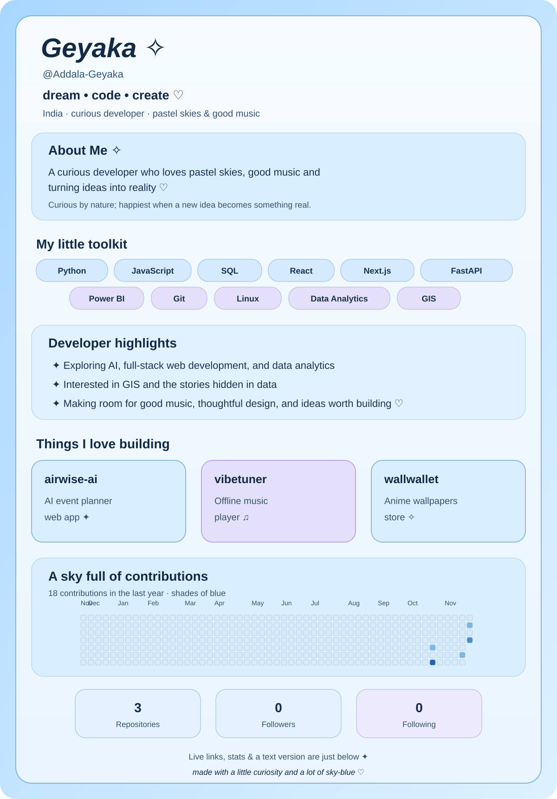

  

Open the accessible text version and live GitHub stats

  
  <h1>Geyaka ✧</h1>
  
<em>dream • code • create ♡</em>

  
India · curious developer · pastel skies & good music

### About Me

A curious developer who loves pastel skies, good music and turning ideas into reality ♡

### My little toolkit

  
  
  
  
  
  
  
  
  
  
  

### Developer highlights

✦ Exploring AI, full-stack web development, and data analytics  
✦ Interested in GIS and the stories hidden in data  
✦ Making room for good music, thoughtful design, and ideas worth building ♡

### Things I love building

| Project | A little about it |
| --- | --- |
| **airwise-ai** | An AI event planner web app ✦ |
| **vibetuner** | An offline music player for your favorite moments ♫ |
| **wallwallet** | A cozy home for anime wallpapers ✧ |

### A sky full of contributions

  

  
  
  

  

made with a little curiosity and a lot of sky-blue ✦

